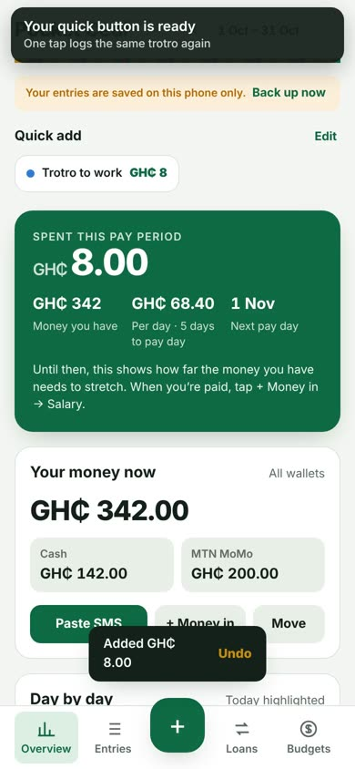

[README (1).md](https://github.com/user-attachments/files/34020554/README.1.md)
# Pocket Cedi

**Track every cedi you spend, in cash and on MoMo, from pay day to pay day.**

Pocket Cedi is a free spending tracker built for how people in Ghana actually handle money: cash in your pocket, MTN MoMo, Telecel Cash and AT Money on your phone, a salary that lands on a set day, and friends who sometimes borrow GH₵ 20 until Friday.

**Open the app:** https://ianyarko.github.io/pocket-cedi/

> 📺 **Reading this much text is not in your budget?** No wahala. Skip all of it and [watch the 1:44 video tutorial](tutorial.mp4) instead. It costs GH₵ 0.00 and doesn't count against your Data & airtime limit (much).

---

## Why this exists

Most budgeting apps are built for bank cards and monthly statements. Day-to-day life here runs on trotro fares, chop money, data bundles, ECG units, susu and MoMo transfers, and those small amounts are exactly the ones that disappear without a trace.

Pocket Cedi started as a personal tool for a simple question: *where did my money go this month?* The goals behind it:

- **Built for local money.** Amounts in GH₵, MoMo wallets next to cash, and categories like Transport › Trotro, Data & airtime, Utilities › ECG prepaid, Church & giving, Family support and Susu.
- **Logging has to be fast.** If adding a GH₵ 8 trotro takes more than a few seconds, people stop doing it. Hence one-tap quick buttons and pasting MoMo messages instead of typing.
- **Budgets that follow your pay.** Periods run from pay day to pay day, not the 1st to the 31st. Before your first salary, the app shows how far the money you already have needs to stretch.
- **Private by default.** No account, no server, no sign-in. Your records never leave your phone unless you save a backup yourself.
- **Works without data.** Once opened, it runs offline.

---

## Features

| | |
|---|---|
| **Spending** | Log an amount, category, detail (e.g. Food › Eating out), wallet, note and tags. Edit or delete any entry. |
| **Paste MoMo SMS** | Paste an MTN MoMo, Telecel Cash or AT Money message. Pocket Cedi reads the amount, fee, recipient, reference, wallet, date and balance, and suggests a category. |
| **Wallet balances** | Cash and each MoMo wallet keep a running balance. A tick box lines your MoMo balance up with the one in the message. |
| **Cash-out & cash-in** | Moving your own money between MoMo and cash is a transfer, not spending. The fee is logged separately. |
| **Budgets** | A monthly limit per category. Amber at 80%, red when you go over, plus a “per day until pay day” figure. |
| **Quick buttons** | Turn a repeat spend (your daily trotro) into a one-tap button, with Undo. |
| **Loans** | Track money you lent or borrowed, part repayments, due dates and overdue reminders, without it counting as spending. |
| **Overview** | Spent this period, money left, a day-by-day chart, breakdowns by category, detail, tag and payment method. |
| **Search** | Find entries by word or tag (`bolt`, `lunch`, `#work`). |
| **Backup & restore** | Save everything to one file; restore it on a new phone. |
| **Export** | Download all entries as a CSV file to open in Excel. |
| **Tour & help** | A short welcome tour, a video tutorial and answers to common questions, all inside the app. |

---

## Getting started

### 1. Install it on your phone

1. Open **https://ianyarko.github.io/pocket-cedi/**
   - iPhone: use **Safari**
   - Android: use **Chrome**
2. Add it to your home screen:
   - iPhone: tap **Share → Add to Home Screen → Add**
   - Android: tap **⋮ → Install app** (or **Add to Home screen**)
3. From now on, always open Pocket Cedi **from the home-screen icon**.

> **iPhone tip:** the home-screen icon keeps its own saved data, separate from Safari. Pick the icon and stick to it.

### 2. Add the money you have now

On **Overview**, tap **+ Money in**, choose **Money I already have**, enter the amount and pick where it is (Cash, MTN MoMo…). Add one entry per wallet.

### 3. Set your pay day and budgets

Open the **Budgets** tab:

1. Under **Pay period**, choose the day your salary usually lands.
2. Under **Monthly budgets**, type a limit for each category you want to control. Leave the rest empty.
3. Tap **Save budgets**.

When your salary arrives, add it with **+ Money in → Salary** (or paste the salary SMS). The monthly budget starts from your first Salary entry.

### 4. Log what you spend

**Cash or anything typed in:** tap the green **+**, enter the amount, pick a category and detail, choose how you paid, and tap **Add spending**. Tick **Save as a quick button** for things you buy often.

**MoMo payments:**

1. In your messages, press and hold the MoMo message and tap **Copy**.
2. In Pocket Cedi, tap **Paste SMS**, paste it, and tap **Read message**.
3. Check the preview. If the type is wrong, switch it (Spending, Money in, Cash-out, Cash-in, I lent it).
4. Tap **Continue**, confirm the category, and save. Keep **Match my balance** ticked.

### 5. Lent or borrowed money?

Use the **Loans** tab: **+ I lent money** or **+ I borrowed**. When someone pays you back, open the loan and tap **Record repayment**, or just paste their MoMo message and Pocket Cedi will ask if it’s them paying you back.

### 6. Back up every week

In **Budgets → Backup & restore**, tap **Save backup** and keep the file somewhere safe (Files, iCloud Drive, Google Drive, email). To move to a new phone, install Pocket Cedi there and tap **Restore**.

Prefer to watch? Open the app and tap **? → Watch the video instead**, or go to **Budgets → Help**.

---

## How the MoMo reader picks a category

The reader is confident about the facts in the message (amount, fee, wallet, balance, who you paid) because MoMo messages follow fixed formats. The **category is a suggestion**, chosen in this order:

1. **People you’ve paid before:** it reuses the category you picked last time for the same name.
2. **Keywords** in the name or reference: `BUNDLE` → Data, `ECG` → Utilities, `Bolt` → Transport, `Pharmacy` → Health, `Shoprite` → Groceries, `Chop bar` → Eating out, and more.
3. **No clue:** it leaves the category empty for you to pick.

Tip: when sending MoMo, type a clear reference like `lunch` or `data` instead of a random one. The app reads it.

---

## Privacy

- There is no server and no account. Pocket Cedi stores everything in your phone’s browser storage.
- Nothing you log is ever uploaded, including to this repository.
- The only network requests are for the app files themselves, the fonts and, if you tap play, the tutorial video.
- Because the data lives on one phone, **deleting the app or losing the phone without a backup means losing your records.** Back up weekly.

---

## Frequently asked questions

**My balance doesn’t match my MoMo message.**
Paste the latest MoMo message and keep “Match my balance” ticked. Pocket Cedi adds a small correction so the two agree again.

**What counts as spending?**
Only what you buy or pay for. Cash-outs, cash-ins and loans move money between wallets or people and don’t count against your budget.

**My salary came in but the budget didn’t start.**
Open that entry and make sure “What is it?” is set to **Salary**.

**Can other people see my entries?**
No. Each person’s entries stay on their own phone.

**Does it work on Android?**
Yes. Use Chrome and choose **Install app**.

---

## Project structure

Pocket Cedi is a single-page web app with no build step and no dependencies.

| File | What it is |
|---|---|
| `index.html` | The whole app: layout, styles and code |
| `manifest.webmanifest` | App name, colours and icons for “Add to Home Screen” |
| `sw.js` | Service worker that lets the app open offline |
| `icon-192.png`, `icon-512.png`, `icon-maskable-512.png`, `apple-touch-icon.png` | App icons |
| `tutorial.mp4`, `tutorial-poster.jpg` | Video tutorial and its preview image |

It is hosted for free on **GitHub Pages** from the `main` branch.

### Releasing an update

1. Upload the new `index.html` (and any other changed files) to the repository.
2. In `sw.js`, bump the version line, e.g. `pocket-cedi-v4` → `pocket-cedi-v5`, and upload it too.
3. Wait for the green ✓ next to **github-pages**. Phones pick up the new version the next time the app is opened online.

---

## Ideas for what’s next

- Savings goals (rent advance, school fees, a new phone)
- Susu tracker with payout dates
- Salary breakdown: SSNIT and PAYE from gross pay
- Bill reminders for ECG, water, rent and data
- This period vs last period comparison
- PIN lock

Suggestions and bug reports are welcome. Open an **Issue** on this repository and, for MoMo messages that aren’t read correctly, paste the message with any personal names and numbers replaced.

---

Made by [@iaNyarko](https://github.com/iaNyarko) in Accra, built with the help of Claude.
